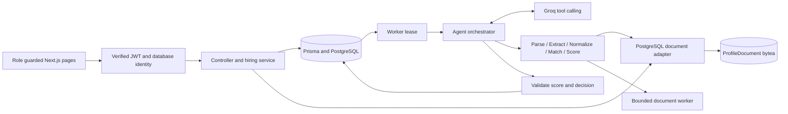

# Contract hiring module

Current local deployment and evidence are summarized in [SUBMISSION_STATUS.md](SUBMISSION_STATUS.md). The user reconfirmed PostgreSQL document storage on 2026-10-11; S3 remains intentionally out of scope for this local variant.

## What changed and why

Implemented the vendor and hiring manager workflows from `Round_One_Task.pdf` inside the supplied repository. At the user’s request, this stage stores document bytes in PostgreSQL instead of S3; that intentionally changes the PDF assignment’s storage requirement. The feature adds tenant-scoped openings, private PDF/PPTX uploads, asynchronous tool-calling recommendations, and shortlist/reject decisions. New source and test files contain no code comments; explanations live here. Existing unrelated source comments and modules are retained.

The setup guide supplied integration context. Its instruction to publish to another repository was not treated as a request to publish, and its example credentials were not copied into the application. The Groq provider reads the server-only `LLM_API_KEY` setting (with `GROQ_API_KEY` retained as a backward-compatible fallback). No packages or external infrastructure products were added to the application's dependency manifests.

The original project provides Express/TypeScript, Next.js, Prisma/PostgreSQL, Keycloak, AWS SDK, AJV, Vitest, and react-dropzone. The implementation reuses them. Groq uses Node's native HTTP client. The existing PDF library performs PDF extraction; a bounded ZIP/OOXML reader handles PPTX without adding an archive service or package.

## Module boundaries

| Location | Responsibility and rationale |
| --- | --- |
| `Zelosify-Backend/Server/src/modules/hiring/routes.ts` | Registers HTTP endpoints, authentication/role middleware, correlation IDs and module error handling. |
| `controller.ts` | Converts HTTP inputs and outputs. It contains no scoring or workflow policy. |
| `auth.ts`, `domain.ts` | Verifies Keycloak identity, derives tenant/role from the database, and defines reusable ownership predicates. |
| `validation.ts` | Compiled AJV schemas and bounded pagination/file validation. |
| `repository.ts` | Scoped reads, explicit persona response projections, serializable transaction helper and bounded conflict retries. |
| `service.ts`, `upload-ticket.ts` | Upload reservation/signing, immutable upload completion, atomic submission, soft delete, decisions and recommendation re-runs. |
| `storage.ts` | PostgreSQL `bytea` document storage, scoped retrieval, SHA-256 integrity checks and immutable transactional writes. |
| `parser.ts`, `workers/resume.cjs` | Bounded document extraction in terminable worker threads so parsing cannot freeze the API event loop. |
| `agent/provider.ts` | Groq function-calling transport, response validation and cancellation. No SDK dependency is needed. |
| `agent/tools.ts`, `scoring.ts` | Stateful tool registry and pure skill, experience, location and weighted-scoring policy. |
| `agent/orchestrator.ts` | Bounded LLM/tool loop, schema validation, malformed-output retries and final decision verification. |
| `recommendation-service.ts`, `worker.ts` | Durable job claims, crash recovery, retry scheduling and atomic result publication. |
| `Zelosify-Frontend/src/features/hiring` | API client, cancellable query/polling hook, server authorization, scoped styling and reusable UI components. |
| `Zelosify-Frontend/src/app/(Hiring)` | Thin role-specific routes and layouts, loading states and error boundary. |

The inherited AWS listing controller now initializes its legacy adapter only when that endpoint is called, so API startup no longer requires AWS configuration. Other inherited AWS functionality remains available when separately configured.

Shared changes are limited to registering the new backend router, extending Prisma, exposing navigation and middleware routing, and fixing the frontend ESLint integration. A separate route group avoids the existing dashboard's mobile-blocking overlay while preserving the old dashboard.

## Request and job flow

## Authorization and tenancy

The new module verifies RS256 signatures using cached Keycloak JWKS keys, issuer, expiration, authorized client (`azp`), and an optional configured audience. The user's current tenant and role are read from PostgreSQL for every request, rather than trusting client fields or a stale role cache. Both database role and signed token role must allow access.

Vendor opening queries include `tenantId`. Their profile queries additionally include `uploadedBy`, including preview, delete and reservation completion. Manager queries include both `tenantId` and `hiringManagerId`. Cross-owner and cross-tenant resources return 404. Wrong personas return 403. Anonymous, forged, expired and wrong-client tokens return 401. Cookie-authenticated writes require the configured frontend Origin to prevent cross-site mutations.

Vendor response projections omit recommendation fields, storage keys, reasoning metadata and other vendors' profiles. Counts use the same visibility filter as profile lists. Manager projections expose the score, confidence, explanation, processing state and latency, but omit raw storage and execution internals.

Frontend server layouts call the authenticated backend session endpoint before rendering either persona's workspace. The middleware handles navigation redirects; it is not the security authority. The API always rechecks authorization.

The migration adds a composite foreign key from an opening's manager and tenant to the user record. An opening therefore cannot point to a manager in another tenant. User roles are still checked at the application boundary.

## Storage and upload protocol

`ProfileDocument` holds only the document key, binary bytes, SHA-256 checksum and creation time. A foreign key ties it to `ProfileUpload`, where ownership, file metadata and opening/tenant scope already live. Keeping the blob in a separate relation prevents ordinary profile and opening queries from loading megabytes of file content. The database enforces a binary size bound of one byte through 10 MB and checksum format.

The presign endpoint keeps its existing route for frontend compatibility and returns an HMAC-signed **backend upload path**. It does not contact S3. The signature binds the reservation, opening, authenticated uploader, expiry, size and media type. The database reservation expires after fifteen minutes and authorization is required even with a valid signature.

1. Validate a batch of one to ten files, each at most 10 MB. Accept PDF and PPTX only; reject path separators, control characters and mismatched extensions/types.
2. Transactionally create upload reservations. Limit each vendor to fifty unexpired, unconsumed reservations.
3. Upload bytes to the signed backend path. Within one serializable transaction, recheck ownership and expiry, validate size/type/file magic, insert the `bytea` document, and mark the reservation uploaded. A failure rolls back both bytes and upload state. Identical retries reuse the same document; different bytes for an existing key return 409.
4. Submit reservation IDs. A serializable Prisma transaction verifies that every document exists, creates profiles and durable jobs together, and consumes every reservation, or rolls back the whole batch. Document-existence checks select only keys, never file bytes.
5. Retrying the same submitted reservation IDs returns the same profiles without duplicate jobs. The browser retains the batch during a failed attempt so a lost response can be retried safely.
6. Serve authorized file bytes through the backend with private/no-store caching, safe content disposition and a sandbox policy. PDFs open inline; PPTX files download for a local viewer.

Keys use `<tenantId>/<openingId>/<timestamp>_<reservationId>_<sanitizedFilename>`. Keys are generated by the server and are not filesystem paths or object-store locations. The additional reservation identifier prevents collisions. Soft deletion retains audit records and database document bytes while removing read, decision and worker-publication access.

The adapter uses bounded buffers for the 10 MB maximum and checks SHA-256 on reads. Every read scopes the document through its reservation’s tenant and uploader; the service additionally checks profile visibility and manager ownership. A new adapter or process reads the same committed database bytes. There is no in-memory or disk-file fallback.

PostgreSQL staging trades object-store scalability for simpler local operations and a single transactional boundary. Database backups now include document bytes; configure database transport/disk encryption and capacity accordingly. Expired, unconsumed uploads and soft-deleted documents remain retained until an explicit retention policy removes them. Deleting a reservation cascades to its blob, so cleanup must be restricted to expired, unconsumed reservations.

The new migration renames existing `s3Key` columns to `documentKey` and preserves their values and indexes. It does not download historical S3 objects. If an earlier S3 deployment has real files, backfill their bytes into `ProfileDocument` using the corresponding reservations before switching those records to this deployment, or re-upload them. Missing document bytes produce a clear 404 rather than a fabricated preview. No historical migrations were rewritten for this change.

## Transactions and worker recovery

`ProfileUpload` tracks upload intent and `ProfileDocument` holds committed bytes. `RecommendationJob` is a transactional outbox and work queue in the existing PostgreSQL database, avoiding an additional broker. Profile creation and job creation cannot partially succeed.

Workers use serializable conditional claims, unique lease tokens and ten-second leases. Processing runs outside database transactions. Multiple workers can run concurrently with a default of four active jobs per worker process. A crashed worker's expired job can be reclaimed. Retries are bounded to three attempts with exponential delay.

Final persistence checks the current lease, state and profile visibility, then writes the recommendation and job completion in one transaction. A deleted profile or stale worker cannot receive a late successful result. Failed attempts store a sanitized error code, latency, attempt number and available execution metadata. Successful results store validated scores, explanation, confidence, version, time and tool metadata.

Shortlist/reject operations recheck manager scope inside the transaction, record the actor/time, clear incompatible decision fields, and update the opening's action date. Repeating the same decision is idempotent. Re-running a completed recommendation at the current version is a no-op; failed or outdated recommendations can be queued again by their manager.

## Agent execution and validation

The default Groq model is `qwen/qwen3.8-27b`, with `GROQ_MODEL` available as an override. The previous Llama default returned `model_not_found` for the configured account. Qwen supports batched tool calls according to [Groq’s tool-use matrix](https://console.groq.com/docs/tool-use/overview); model availability follows [Groq’s deprecation schedule](https://console.groq.com/docs/deprecations). Provider and execution metadata share the same model resolver. Authentication, unavailable-model and rate-limit failures have distinct sanitized codes.

The production path always uses a real function-calling LLM. The scripted provider exists only under `tests/hiring` and is never selected by production code. Missing Groq configuration does not produce fabricated recommendations.

The orchestrator sends a small opening requirements object, not a raw Prisma model. Tool-call batching is enabled: the model can submit feature extraction and the subsequent state-based tools together, and the registry executes them in dependency order as listed to reduce provider round trips. It gives the model a tool registry and lets the model select tool calls. The registry enforces prerequisites and retains trusted intermediate state:

1. `parse_resume`: retrieve the assigned PostgreSQL document and extract bounded untrusted text.
2. `extract_features`: accept validated experience, skills, location, education and keywords proposed from the document. Reject skills absent from extracted text.
3. `normalize_skills`: normalize aliases and deduplicate the extracted skills.
4. `match_candidate`: pass the registry's structured features to the deterministic matching engine.
5. `score_candidate`: apply the specified formula to the trusted matching output.

State is held server-side so the model cannot substitute arbitrary IDs, storage keys or matching scores. Feature re-extraction invalidates previously derived state. The agent may retry tools, but cannot skip required stages and still persist a result.

Every stage validates its input/output. There are at most ten model turns and two malformed-output/tool corrections. The final response must match the JSON schema and agree with the exact scoring tool result and threshold decision. The model's explanation is accompanied by a server-generated verified breakdown.

Resume text never appears in system instructions. Extraction removes control and bidirectional override characters and caps text at 24,000 characters. Tool results label it as untrusted data. The model has no database, arbitrary file, network-fetch or mutation tools. Schema checks, job-bound access and score verification enforce the boundary even if a resume attempts to instruct the model. These controls limit capabilities; they cannot guarantee that an LLM will interpret all adversarial factual claims correctly. Managers retain the final decision.

Persisted execution metadata includes tool names, success/failure, durations, retries, token usage, model/version and score breakdown. Raw resumes and private model chain-of-thought are not logged or persisted as reasoning metadata.

The PDF worker uses the existing library's bundled `v2.0.550` parser with a `Uint8Array`, disabled dynamic evaluation and disabled font-face loading, correcting a compatibility failure found with the default bundled parser on a valid PDF fixture. PPTX parsing bounds ZIP entry counts, declared and actual decompressed sizes, accepts only supported compression methods, rejects encrypted/multipart archives and XML entity declarations, and extracts slide text in numeric order. Worker memory and execution time are bounded. Scanned/image-only documents fail explicitly; OCR is outside the assignment.

## Scoring policy

| Component | Policy |
| --- | --- |
| Experience | Below minimum: 0. Inclusive range: 1. Above an explicit maximum: 0.8. A missing maximum is unbounded. |
| Skills | Unique normalized overlap divided by unique normalized required skills. No required skills means no skill restriction, therefore 1. |
| Location | Remote opening or normalized exact match: 1. Onsite mismatch or unknown location: 0.5. |
| Total | `0.5 × skills + 0.3 × experience + 0.2 × location`, rounded to six decimals. |
| Decision | At least 0.75: recommended. At least 0.5 but below 0.75: borderline. Below 0.5: not recommended. |

Confidence is a validated model estimate of evidence completeness, not another matching score. Missing experience is represented as zero; missing skills/location remain empty rather than being invented. Database checks constrain stored score/confidence ranges, positive file sizes and valid opening experience ranges.

## Frontend behavior

The vendor list shows role, location, contract, posted date and manager. Detail pages show requirements, experience, dates, multi-file drag/drop, per-file progress, errors and confirmations. Vendors can preview or soft delete their own submissions.

Manager detail cards show processing/completed/failed state, recommended/borderline/not-recommended badge, score, confidence, explanation, latency and decision controls. Failed assessments can be retried. Polling runs only while visible profiles are pending or processing and is cancelled on unmount. Requests cancel when their route or pagination changes.

Both personas share metadata, badges, pagination, loading, errors and theme controls. Page sizes are 20, 50 and 100. Collections above fifty profiles render a fixed-height virtual window with overscan; long explanations scroll inside their card. Responsive layouts work on mobile without the old dashboard overlay.

## Latency and observability

The worker applies a 1500 ms processing abort signal spanning profile loading, PostgreSQL document retrieval, parsing and model/tool execution. It checks the deadline again before result publication. Provider calls and parser workers honor cancellation. Document reads check the abort signal before and after the Prisma query; Prisma does not cancel an in-flight query through that signal. Network/database scheduling and final transaction commit can add overhead; there is no claim of a mathematically exact wall-clock ceiling.

Submission returns after the profile/job transaction; it does not wait for model inference. JSON requests use short client timeouts. Binary upload transfers have a separate 30-second browser transport timeout so large files on slow connections can finish. This is a practical exception to interpreting the assignment's two-second limit as an absolute end-to-end file-transfer bound.

Module logs are structured JSON and include request correlation ID, status, start time, queue delay, parsing/matching tool durations, token usage, final score, retries, sanitized errors and processing latency. Legacy modules retain their existing logging behavior. Queue delay is reported separately from processing time.

A free hosted model requiring several tool-calling round trips may exceed 1500 ms. Such attempts fail/retry rather than report a fictitious success. The live Groq smoke check on 2026-10-09 timed out under the production 1500 ms budget. A separate diagnostic with a 15-second limit read a PDF from PostgreSQL, parsed it and completed all five real Groq tool stages in 2252 ms, returning a validated score of 1. This diagnostic did not publish a worker result or relax the worker deadline. Another probe encountered the account’s rate limit. The longer limit was used only by the diagnostic; production remains at 1500 ms. Successful live SLA compliance is therefore not established. Deployment-scale throughput and API P95 still require measurement.

## Validation performed

- Backend TypeScript build and Prisma generation pass.
- The additive migration applies to real PostgreSQL; the Bruce Wayne Corp seed creates twelve varied openings.
- The complete backend test run passes: 69 tests, including existing tests, policy boundaries, malformed output, prompt isolation, real parsers and HTTP/database integration.
- HTTP integration uses real RS256-signed tokens and a local JWKS endpoint, real PostgreSQL transactions, real PostgreSQL blob storage and a test-only model adapter. It covers upload → submit → recommend → shortlist, cross-tenant/cross-vendor/cross-manager access, origin checks, replayed submissions, rollback, concurrent claims and deletion during inference. Additional tests cover durable blob retrieval, cross-tenant adapter access, immutable retries, missing-byte rejection, and rollback after a blob write.
- The 100-profile performance test uses real PDF/PPTX parsers and a scripted model. One isolated run completed 100/100, processing P95 126 ms, maximum 147 ms, queue-delay P95 1484 ms, total 1686 ms at concurrency four. These earlier parser/agent measurements are not live Groq results or database-inclusive throughput measurements.
- The hiring frontend lint check and production build pass. Chromium checks covered vendor listing/upload, hidden vendor recommendations, dark mode, 390 px mobile layout without horizontal overflow, manager shortlist/reject, virtualization with 66 profiles, and anonymous/wrong-role redirects, with zero page errors.
- The legacy repository-wide frontend lint command exposes ten pre-existing errors and sixteen warnings in unrelated files. Build lint is scoped to the new hiring feature; `npm run lint` still reports the legacy issues instead of silently disabling those rules.

See `HIRING_SETUP.md` for environment configuration, launch commands and repeatable tests. Local Keycloak registration/TOTP and vendor routing have since been verified in Chromium. Live Groq SLA compliance remains unmet; the current 100-profile evidence is in `validation/live-performance.json`. Remote submission still requires authenticated access to the user-owned repository.
